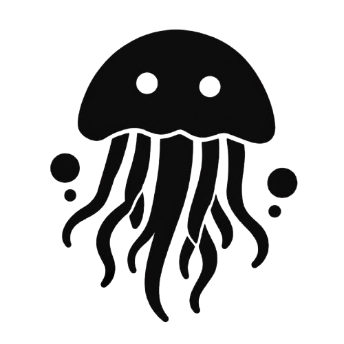

<h1 align="center">Jellyfish Parental Controls</h1>

  <strong>Less fighting. More Jellyfish.</strong>
   
  A different approach to parental controls for Windows.

  <a href="https://jellyfish-controls.netlify.app/">Website</a> ·
  <a href="https://jellyfish-controls.netlify.app/">Download</a>

---

## About

Jellyfish is a free parental control application for Windows that allows parents to manage their children's computer usage through a separate parent interface.

Instead of focusing exclusively on restrictions and lockouts, Jellyfish aims to make screen time management more understandable and less frustrating.

## Features

| Feature | Description |
|---|---|
| Remote management | Manage a child's Windows PC remotely |
| Screen time | Set and manage computer usage limits |
| Automatic locking | Lock the computer when time runs out |
| Interactive lock screen | Puzzles, facts and activities |
| Simple interface | Designed with usability in mind |
| BYODB | Use your own database infrastructure |

## Privacy

Jellyfish is designed around a privacy-focused approach.

- No advertisements.
- No tracking.
- No mandatory subscription.
- No mandatory centralized Jellyfish account.
- Bring Your Own Database (BYODB).

Users are responsible for configuring and managing their own backend infrastructure.

## Platform

- Windows 10
- Windows 11

## Download

Get Jellyfish from the official website:

  <a href="https://jellyfish-controls.netlify.app/">
    <strong>jellyfish-controls.netlify.app</strong>
  </a>

## License

Jellyfish is proprietary software.

The source code is publicly available for viewing and educational purposes, but the project is not open-source software.

All rights reserved. Unauthorized copying, modification, redistribution and commercial use are prohibited.

See [LICENSE](LICENSE) for details.

## Disclaimer

Jellyfish is provided free of charge, as-is and without warranties of any kind.

Jellyfish is an independent project and is not affiliated with, endorsed by or associated with Microsoft.

---

  Independently developed by Maciej Goszczyński · 2026
   
  🪼 Jellyfish Parental Controls

